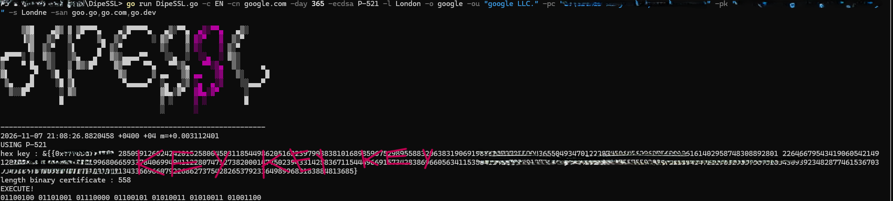

✕⁊⌂৻৹⨀⨆⨉⩀⩔ *dipieSSL* ⩔⩀⨉⨆⨀৹৻⌂⁊✕

> **CLI Tool for ECDSA X.509 Certificate & Private Key Generation**

<p align="center">
  <a href="https://golang.org"></a>
  <a href="#"></a>
  <a href="#"></a>
  <a href="#"></a>
  <a href="#"></a>
</p>
---

### ⌂৻ Overview

**dipieSSL** is a lightweight, high-performance CLI utility written in Go designed for rapid generation of self-signed X.509 SSL/TLS certificates utilizing Elliptic Curve Cryptography (ECDSA).

⨀ **Cryptography:** Native support for curves `P-256`, `P-384`, `P-521`

⨆ **Autonomy:** Zero external dependencies (pure Go standard library)

⨉ **Export:** Automated serialization of keys and certificates into standard PEM format

---

### ⩀⩔ Installation & Prerequisites

#### ⨀ Prerequisites

✕ Installed [Go 1.18+](https://go.dev/dl/)

✕ Git (for cloning repository)

#### ⨆ Installation

```bash
# Clone repository
git clone https://github.com/your-username/dipiessl.git
cd dipiessl

# Build binary
go build -ldflags="-s -w" -o dipiessl main.go

# (Optional) Move to system PATH
sudo mv dipiessl /usr/local/bin/

```

---

### ⌂৻ Execution Example

```bash
dipiessl \
  -cn "dipie.local" \
  -san "dipie.local,localhost,127.0.0.1" \
  -day 365 \
  -ecdsa "P-256" \
  -c "US" \
  -o "Dipie Security LLC" \
  -ou "IT Department" \
  -l "Berlin" \
  -s "Washington" \
  -pc "./server.crt" \
  -pk "./server.key"

```

---

### ⨀ Flag Specifications

| Flag | Description | Example | Required |
| --- | --- | --- | --- |
| `-cn` | Common Name (CN) | `dipie.local` | **Yes** |
| `-san` | Subject Alternative Names (SANs) | `a.com,b.com` | No |
| `-day` | Certificate validity period (in days) | `365` | No (default: 365) |
| `-ecdsa` | ECDSA curve type (`P-256`, `P-384`, `P-521`) | `P-256` | No (default: P-256) |
| `-c` | Two-letter Country Code | `US`, `DE` | **Yes** |
| `-o` | Organization | `Dipie Security` | **Yes** |
| `-ou` | Organizational Unit | `IT Dept` | **Yes** |
| `-l` | Locality / City | `Berlin` | **Yes** |
| `-s` | State / Province | `Washington` | **Yes** |
| `-pc` | Output file path for `.crt` | `./cert.crt` | **Yes** |
| `-pk` | Output file path for `.key` | `./key.key` | **Yes** |

---

### ⨉ Code Architecture

* **`createKey()`** ✕ ECDSA private key generation matching NIST curves.
* **`createX509Certificate()`** ⁊ X.509 certificate structure creation with SANs support and `KeyUsage` constraints.
* **`saveAndKeyToPEM()`** ৻ Writing PEM-encoded `CERTIFICATE` and `EC PRIVATE KEY` blocks directly to disk.

---

### ▨ Screenshot


---

### ⩀⩔ License

[MIT License © 2026](LICENSE)

`01100100 01101001 01110000 01100101 01010011 01010011 01001100`
